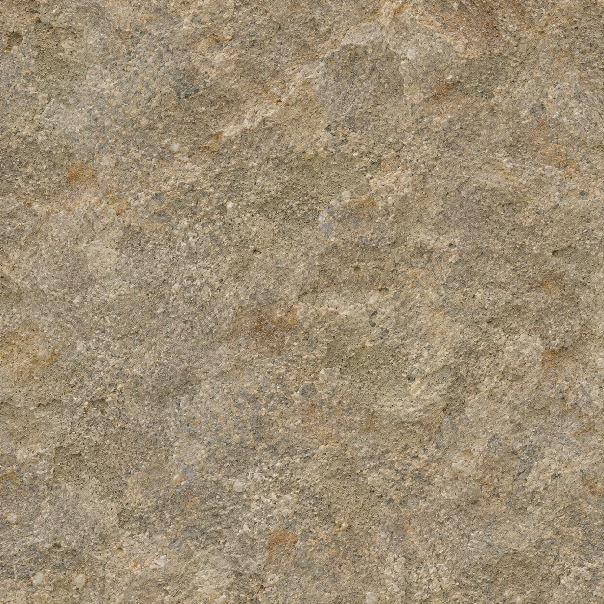
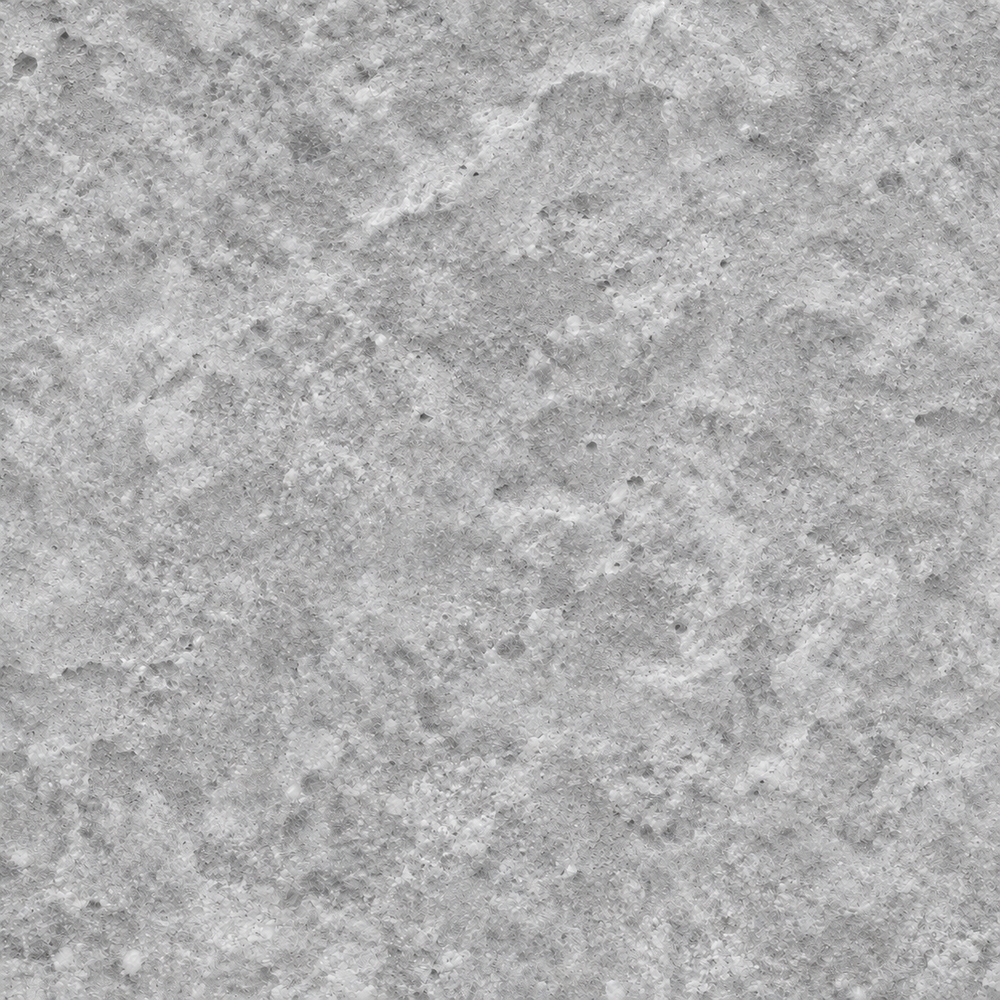

# ROUTE-MAT-01 — オリジナル石表面画像の引き継ぎ

Issue #359／制作方式PR #358に基づくCodex画像担当の候補納品。**実画像生成済み。正式採用ではありません。** Claudeが新しい全厚石積み・UV・目地・橋台接触を制作するための素材です。

| 実ファイル | 内容 | Blender指定 |
| --- | --- | --- |
| `stone_basecolor.png` | 1254×1254 RGB PNG。石の粒子、鉱物、穏やかな風化色。壁や石の並びを描かない連続表面 | sRGB → Principled Base Color |
| `stone_roughness.png` | 同サイズRGB PNG。ベースカラーから生成した推定ラフネス。測定スキャンではない | Non-Color → Separate Color **Red** → Roughness |
| `manifest.json` | `lind.material-handoff.v1`。実SHA、参照SHA、色空間、権利、用途、QA範囲 | 既存validatorで照合 |
| `generation.json` | 実際の全文prompt・編集入力・生成ツール・要求/実寸法・元出力の記録 | seed/backend非公開を明記 |
| `load_material.py` | SHA照合後、正しい色空間とR配線で新しい候補materialのみ作成 | 既存mesh・materialを置換/割当/保存しない |
| `inspect_images.py` | 読み取り専用のPNG・統計・位置ずれ・端の検査 | Pillow/NumPy、再生成処理なし |

## 画像プレビュー

| Base color | Roughness（実装はRのみ） |
| --- | --- |
|  |  |

## 制作条件と権利

OpenAI `image_gen.imagegen`でベースカラーを新規生成し、その実画像を入力してラフネスを生成。モデル名・backend version・seedはAPIから返されないため捏造していません。要求2048角に対して実出力は**1254角**。拡大・切り出し・補正・チャンネル再計算等のピクセル後処理はせず、生成PNGを同一bytesで保存しました。元生成ファイルも削除していません。

正式橋CG `assets/approved/game/rilde_story/raid/attack_background_only.png` と正式ワールド画像を実閲覧し、色/石の風化の方向性のみ参照。CGを画像生成入力にせず、参照ピクセル・外部stock素材・他者のテクスチャを流用していません。オリジナルAI生成候補として本プロジェクト向けに納品し、利用にはOpenAIサービスの適用規約を参照してください。CC0や排他的著作権を捏造しません。

PR #351の実blend・失敗画像・独立美術判定・累積台帳も確認済み。旧「矩形/細胞状の自動facing geometry」は2FAIL停止のまま、既存modelと支持構造には一切変更していません。新素材は石面の画像であり、停止方式の石並べを画像化して偽装したものではありません。

## Claudeへの組み込み手順

1. このブランチを取得し、manifestと画像SHAを検証する。
2. **新しい小区画の全厚石**と実際の目地/接合を制作する。旧facingや平面shellへ貼って完成扱いにしない。
3. 個別石のUV島を画像の内側に配置し、両mapへ同じUV/回転/scaleを使う。コピー模様を避けるため石ごとのUV領域を変える。採用済み寸法がないためメートル換算はしていない。
4. `create_material(repo_root)`で候補materialを生成し、Claude所有の新規候補meshにのみ割り当てる。既存の正式materialを置換しない。
5. 近景・全体・ゲーム距離・48px previewを実レンダーし、光応答・UV・継ぎ目・目地・支持・法線を独立QAする。

ラフネスRGBには最大9/255の成分差があるため、**Color全体の自動変換でなくRだけ**を使ってください。R中央値は約.694。両画像は全体の位相相関で0pxずれですが、微細部の物理的対応までは保証しない推定mapです。

端の画素連続性は保証していません。初期loaderは`CLIP`、UVは0–1の内部。無条件のseamless repeat用として配布しません。画像を壁全体へ規則的にスタンプしないでください。

Normal/heightは未納品です。色の明暗を高さと偽らず、必要な凹凸はClaudeが新しい実形状からbake/検証してください。目地maskも石面画像に焼き込まず、実際の石/目地の面所有に合わせて制作します。

```sh
python3 tools/material_pipeline/validate_material_handoff.py assets/candidates/route-mat-01/attempt-01/manifest.json
python3 assets/candidates/route-mat-01/attempt-01/inspect_images.py --out /tmp/route-mat-image-qa.json
blender -b --factory-startup --disable-autoexec --python-exit-code 1 --python assets/candidates/route-mat-01/attempt-01/load_material.py -- --root "$PWD" --report /tmp/route-mat-node-load.json
```

## 実施QAと引き継ぎ境界

- G1: 正式参照と保護素材のSHA、生成元/利用条件の記録を照合。寸法・配置の正式採用なし。
- G2: 画像担当自己確認のみ。規則的な矩形/セル壁模様、文字/枠/大きな光源は見られず、粒子/色の変化は実画像で確認。**Claudeの新形状での独立美術QAはNOT_RUN**。完成した橋のG2 PASSを主張しない。
- G3: PNG decode/実寸法/実SHA/同サイズ/位置ずれ、既存manifest validator、Blender4.3.2でmaterial nodeと色空間/R配線の読込検証がPASS。既存6テストPASS。UV/支持/形状/保存blend再openはClaude工程のNOT_RUN。
- G4: ゲーム/Android NOT_RUN。

本素材方式の有効試行は1回（base＋対応roughnessを一組として記録）。独立QAが同一原因・同一方式で2回FAILしたら停止し、旧失敗履歴も含めて保持する。mainマージ、正式アセット置換、公開、広域展開は実施しない。
