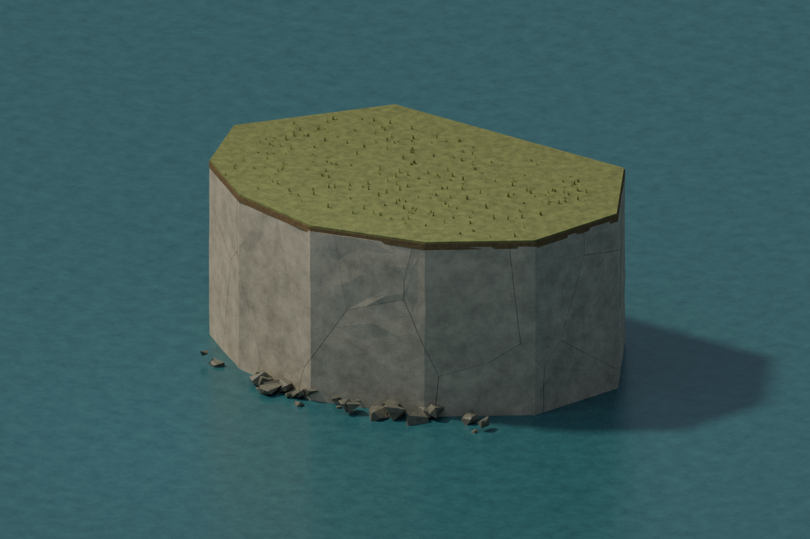
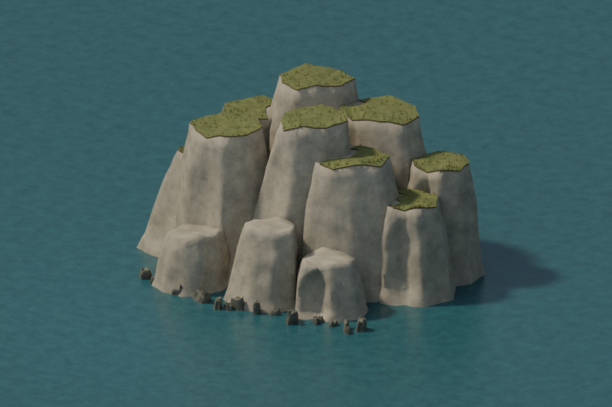
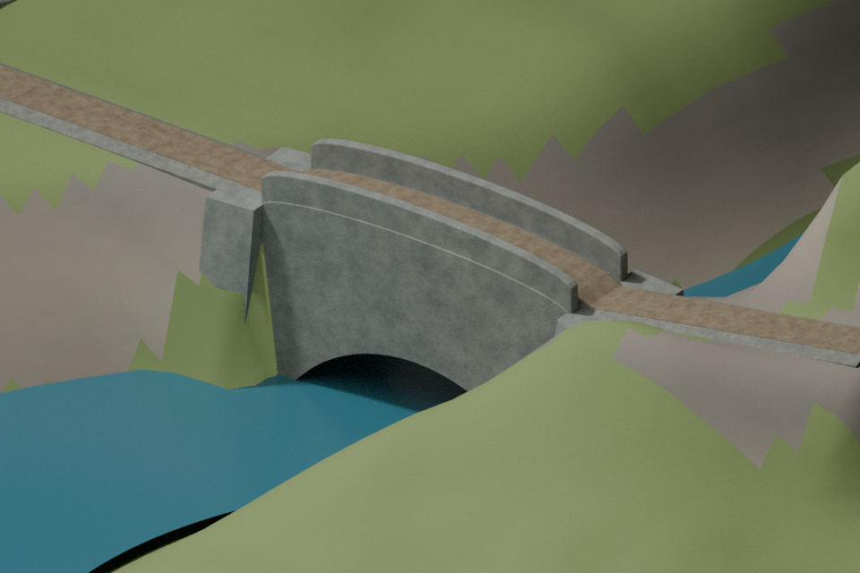

# WORLD / ROUTE actual production and independent review

**Final-quality adoption is not achieved.** Actual bounded models, renders, repairs and independent QA were executed. Final G2 is FAIL; stopped methods are not expanded to the village. Branch: `feature/lind-geology-route-production-01`, Draft PR #351. Original D, official PNG/CG assets, earlier failed candidates and the original failure ledger are unchanged. No main merge, release or formal adoption.

## Final actual artifacts

| Unit | Actual blend | Three actual PNGs |
| --- | --- | --- |
| WORLD | `assets/candidates/lind-geology-route-production-01/world/attempt-04-technical/world.blend` | `overview.png`, `detail.png`, `gameplay-distance.png` |
| ROUTE | `assets/candidates/lind-geology-route-production-01/route/route.blend` | `overview.png`, `junction-detail.png`, `gameplay-distance.png` |

All six final PNGs were opened by root using image tools. Root is independent of the two producer workers. Exact hashes, criteria and reference hashes are in `independent-art-review.json`. This is Codex independent review, not Claude, director approval or Android testing. CI creates separately versioned images; a CI result is not a claim those particular CI pixels were artistically reviewed.

## Before / after (not a PASS comparison)

WORLD is a bounded local sector with an unapproved scene transform; this is method development, not a registered full-map geographic before/after.

| WORLD initial clipped sector | WORLD final stopped candidate |
| --- | --- |
|  |  |

| ROUTE initial support-only bridge | ROUTE final stopped facing candidate |
| --- | --- |
|  |  |

| WORLD near / study distance | ROUTE near / study distance |
| --- | --- |
| [Near image](../../../../assets/candidates/lind-geology-route-production-01/world/attempt-04-technical/detail.png) / [Study distance](../../../../assets/candidates/lind-geology-route-production-01/world/attempt-04-technical/gameplay-distance.png) | [Near image](../../../../assets/candidates/lind-geology-route-production-01/route/junction-detail.png) / [Study distance](../../../../assets/candidates/lind-geology-route-production-01/route/gameplay-distance.png) |

## Causal work and stop decisions

WORLD halfspace joint-cell family failed twice because the shared clipping envelope and continuous turf cap still read as concrete pillars. It was stopped; geometry defects were retained and repaired without changing that artistic verdict. A structurally different individually authored outcrop/soil family then produced two trials: pointed pillars and unsupported sparse soil fans were replaced with broader shoulders and soil extruded from actual bedrock triangles. This still reads as smooth artificial pillars and flat grass lids in all three views. That family is also stopped after two same-defect artistic failures. No third artistic parameter pass was made.

A separate local technical repair rebuilt only the folded talus00 skin from existing vertices as a convex hull. Original 04, its 21 nonadjacent triangle overlaps, negative volume and images remain preserved. The corrected volume is positive/manifold; the other 463 meshes' vertex/face hashes are unchanged. This is not a new artistic trial or G2 pass.

ROUTE initially added closed bearing volumes to immutable D roads but independent triangle sampling disproved support at crossings (up to .10293 protrusion, .10452 junction step). A shared constrained junction plane, graded approaches, matching support surfaces and extended ends repaired this defect. Actual renders then exposed coplanar z-fighting; road-face ownership was changed to a single shared junction fan without regenerating accepted support geometry. Stone-facing repair changed regular rectangular veneer to polygon bond surfaces on arch, abutments and parapet, but independent images still show an artificial cell/facet pattern. The automatic-facing family is stopped after two same-defect failures. One fully buried folded decoration was excluded with dense occlusion evidence; visible invalid geometry hard-fails rather than being hidden by a normal flip.

## G1–G4

| Gate | Result and limits |
| --- | --- |
| G1 | Protected original/packed-source SHA subset PASS. Full metric, event, placement, source/CG spatial acceptance **BLOCKED**. No image scale bar or candidate coordinate is promoted to an approved dimension. |
| G2 | **FAIL**, independent exact-image review performed. WORLD: smooth pillars/capped grass, insufficient joints/erosion. ROUTE: artificial cell/facet masonry and material/weathering mismatch. No approved-quality asset is claimed. |
| G3 | **PARTIAL TESTED SUBSETS PASS** after real saved-blend reopening. WORLD 464 owned meshes and ROUTE 214 owned meshes: finite geometry, nondegenerate triangles, classified boundaries, normal consistency, positive closed volumes, source/manifest hashes and three PNGs checked. ROUTE 9,400 triangle samples: no missing support, no terrain burial, candidate grade <25°, no detected coplanar road-interior overlaps. Four road/shared-fan seam differences <=.0000248 candidate units. Nine WORLD soil volumes pass sampled attachment checks. |
| G4 | **NOT_RUN**: no production runtime integration, physical movement/collision/navmesh, performance or actual Android validation. |

The 25°/.03/.02/.015 thresholds are provisional study checks, not approved gameplay or civil-engineering tolerances. Seven WORLD boundary-ray misses are retained in raw measurements and corroborated by nearest points on the exact named source triangles at the known .025Z offset within .0001 units. The negative control (failed outcrop trial03) still fails all eight real unsupported pockets; no tolerance was loosened to hide them. Global unintentional intersections, loading/engineering, collision/navmesh, budgets and runtime are NOT_RUN, not full G3 PASS.

## CI, caching and continuation boundary

Existing PR #350 workflow/runner is reused with a production profile, two independent producer scripts and separate saved-blend QA. The production configuration cannot assign G2 PASS. CI reproduces the authored candidates, retains inherited art FAIL, and can package only measured technical evidence. It is not another corrective art trial. No AI service is called. Per-unit producer changes keep the other unit's input key stable (tested); exact successful artifacts are reused and unchanged failures cannot auto-rerun. Detailed commands, token-minimal handoff and storage limits are in `docs/production/map-pipeline/OPERATIONS.md`. Actual CI run/artifact links are recorded on PR #351 after result verification.

Next autonomous task is a structurally different, reference-driven sculpt/curated full-thickness masonry recipe with a measurable bounded acceptance hypothesis and approved shared boundary contract. It is **not implemented**. Do not resume the stopped pillar or automatic-facing families, expand failed art across the map, adopt unofficial dimensions or integrate the scenes while G1/G2 are blocked. Approval of physical scale/camera/placement remains a missing design gate; runtime/Android needs its own environment and evidence. HOME/ECO remain out of scope.
